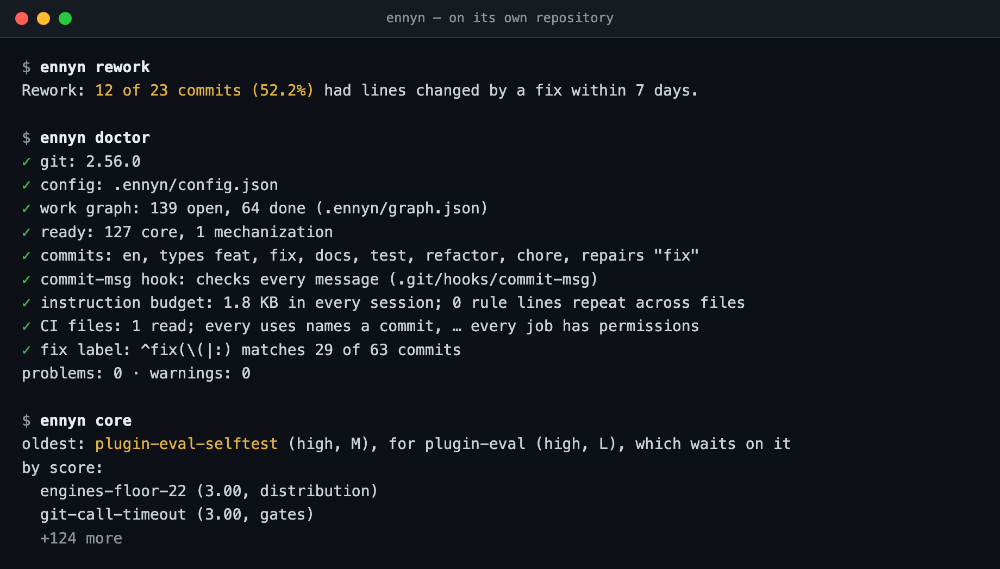
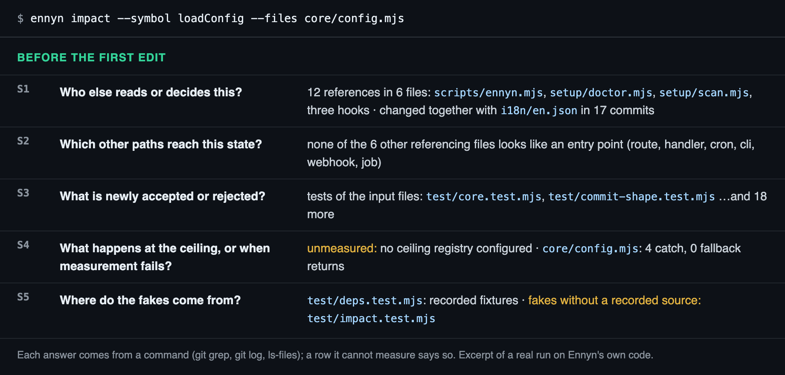

# Ennyn


**English** · [Türkçe](README.tr.md)

[](LICENSE) [](package.json) [](package.json)

Ennyn is a Claude Code plugin and Node CLI. It gives the agent a working routine: impact analysis before code is written, a two-round review, and checks on every commit for recurring classes of bugs.



> Early days (0.0.x). Ennyn is built with Claude Code using its own cycle; its work graph, handoff notes, and metrics are in `.ennyn/` (notes in Turkish, commits in English, as its config asks). The config format may still change before 1.0.

## Why Ennyn

In a project where an agent writes the code, these problems show up over time:

- A review finds a bug, the agent fixes it, and the fix causes a regression nearby. The next review catches the regression, and the loop continues.
- The questions that would prevent these bugs can be asked before the code is written (what else reads this value? can this state be reached another way?), but they usually come up only in review.
- A bug leads to a new prose rule in CLAUDE.md, and a few weeks later a bug of the same class is back.
- CLAUDE.md keeps growing and takes up context in every session, with no way to measure which rules have any effect.

## What it does

- Before editing code, the agent fills in an impact table: five questions about what the change affects, each answered, where possible, by running git grep, git log, or the tests.
- Review gets two rounds. The second round only looks at what the first round's fixes changed. A third round needs a failing test or a measurement behind it.
- When a class of bug recurs, the next cycle (one pass of the loop described below) turns it into a gate: a test or a commit-hook rule. The prose rule for it in CLAUDE.md is then no longer needed.
- Each cycle closes with five metrics: bugs review found, regressions introduced by fixes, old bugs in code from before Ennyn, bugs a gate caught, and bugs that got past the commit and turned up later. It also measures whether the instruction text loaded in every session grew.
- Tasks live in a work graph, a JSON file. Ennyn picks four per cycle and always keeps a slot for the oldest high-value task.

Ennyn has no runtime dependencies and no install scripts. It makes network requests in only two cases. When a commit adds packages to a lock file, the commit hook looks them up on the npm registry (turn that off with `security.deps.online: false`). The `ennyn deps` command queries the OSV vulnerability database when you run it. More in [SECURITY.md](SECURITY.md).

The reasoning behind Ennyn's design is in [docs/evidence.md](docs/evidence.md).

## Try it without installing

Two commands work in any git repository without a config. Clone Ennyn next to your project, then run these from your project's root:

```sh
node ../ennyn/scripts/ennyn.mjs rework
node ../ennyn/scripts/ennyn.mjs budget
```

`rework` reports the share of commits whose lines a fix commit changed within 7 days. `budget` measures the size of the instruction text (CLAUDE.md, rules, and skill and agent descriptions) your agent loads in every session.

## Install (Claude Code)

```sh
claude plugin marketplace add boranb/ennyn
claude plugin install ennyn@ennyn
```

Then run `/ennyn:init` in your project. It scans the repository, asks a few questions, and sets up `.ennyn/`. In your other projects, the plugin's hooks do nothing except note the plugin's version in the plugin's own folder.

Until Ennyn's repository is public, add the marketplace from a local clone with `claude plugin marketplace add ./ennyn`, then run the install command above.

The cycle skill in `skills/cycle/` follows the [Agent Skills](https://agentskills.io) format, but it calls the CLI through `${CLAUDE_PLUGIN_ROOT}`, which only Claude Code sets. To use it with another agent, set `CLAUDE_PLUGIN_ROOT` to the path of an Ennyn clone. The CLI needs Node 20 or later and git 2.34 or later, and has no dependencies. From the Ennyn clone, `node scripts/ennyn.mjs --help` lists its commands. Elsewhere in this README, `ennyn` is short for that script, run from your project.

## How a cycle runs

Before the first edit, the agent runs `ennyn impact`. This is its output for a change to Ennyn:



The steps of a cycle, and the settings that apply to them:

| Step | What happens | Commands |
|---|---|---|
| Setup | `/ennyn:init` looks at the repository before asking anything: how fixes are labeled, which files most commits rewrite (usually generated output), where the tests are, which paths are risky, and whether the project has a roadmap or issues. Then it asks up to six questions and writes the config, a starting work graph, and a handoff note for the next session. | `/ennyn:init`, `ennyn init-scan`, `ennyn doctor` |
| Picking work | Each cycle takes four tasks. One is always the oldest high-value task, so large tasks aren't starved (if it's too big, its first step goes in instead). The other three are the task with the best value for its cost, one that turns the most common kind of bug into a gate, and an audit of something already finished. | `ennyn core`, `ennyn mechanization` |
| Before writing | The impact table. Each of the five questions is answered by a command where possible (git grep, git log, or the tests), and a row no command can answer says so. If the change adds a heuristic, the agent first writes examples the heuristic should accept and reject, plus a failing test. | `ennyn impact` |
| Mutation testing | The agent picks a few mutants (small, deliberate bugs) for the changed lines, and the project's fast tests run once per mutant. A surviving mutant, one the tests miss, needs a new test or a written reason. Files are restored afterward, even if the run is interrupted. If someone edits a file while a mutant is in it, Ennyn leaves that file as it is and stops the run. | `ennyn mutate` |
| Review | Two rounds; a third only with a failing test or a measurement. Every finding quotes the code, names its source (new code, an earlier fix, or older code), and says how it was checked. | `agents/`, `skills/cycle/finding-schema.md` |
| Commit | A commit-msg hook checks every commit. It blocks patterns you've banned (`review.forbidden`) and secrets in known token formats, and warns when code changes but the docs tied to it don't (`review.cochange`). | `ennyn commit-check`, `ennyn install-hook` |
| Gate timing | How long the commit checks take and how often they fail, recorded on your machine. | `ennyn gate-record`, `ennyn gate-stats` |
| Tone | You choose how the agent talks to you (`focused` or `terse`) and how long commit messages are. Numbers, paths, and warnings are never cut. | `conversation.style`, `commitMsg.style` |
| Worktrees | When the agent works in a git worktree or a copy of the project, it still gets the project's path-specific rules. | Claude Code hook |
| Compaction | Claude Code doesn't summarize a session you left in the middle of a task with its turn ended: idle compaction waits for a commit. Compaction a session needs goes ahead as usual, and every summary is asked to name the task, its files and what comes next. `compaction.defer: false` turns both off. | Claude Code hook, `compaction.defer` |
| End of cycle | You get the five metrics, and the most common kind of bug becomes the next cycle's gate task. The agent cleans up one lesson file (the project's written notes on past mistakes) and deletes the lessons a gate now covers. It also checks dependencies and CI files. Every few cycles there's a security audit. The agent always asks before pushing. | `ennyn push-check`, `ennyn rework`, `ennyn bypass`, `ennyn budget`, `ennyn deps`, `ennyn audit` |

`ennyn rework` depends on how your project labels fixes. If most commit subjects start with "fix", it ends up measuring churn more than rework, and says so. Set `metrics.fixSubject` to match your real repair commits; that pattern also has to match `commitMsg.fixType` ([details](docs/evidence.md#speed-and-rework)).

## Configure

All settings live in one file, `.ennyn/config.json`, which `/ennyn:init` writes for you. You only set what differs from the defaults. Unknown keys and wrong types are reported all at once, so a typo can't quietly switch a check off. Paths in the config have to stay inside the project.

```json
{
  "language": "en",
  "paths": { "graph": ".ennyn/graph.json" },
  "commitMsg": { "types": ["feat", "fix", "docs", "test", "refactor", "chore"], "fixType": "fix" },
  "review": { "impactRequiredGlobs": ["src/auth/**", "migrations/**"] },
  "impact": { "twins": [["src/lib/engine", "server/src/lib"]] }
}
```

`language` (`en` or `tr`) sets the language of reports and of the agent's replies. Commit messages follow `commitMsg.language`, so you can talk in Turkish and commit in English. The hook accepts the commit types in `commitMsg.types`, and `commitMsg.fixType` is the type reserved for repairs of earlier commits, the ones `ennyn rework` counts. `/ennyn:init` sets the types and the fix type, and they override any commit rules in your own instructions. The full list of keys is in [DESIGN.md](DESIGN.md).

The work graph is a JSON file (or an ES module) with two arrays, one for open tasks and one for done tasks. Field names can be configured, so you can point Ennyn at a graph you already have.

## Status and roadmap

- **0.1** (next): the first public release, with the plugin, `/ennyn:init`, and the CLI as they are now.
- **0.2**: Codex support, `claude plugin eval` cases that compare a project with and without the plugin, and published results from a second project.
- **1.0**: a stable config format.

## License

MIT. See [LICENSE](LICENSE).

## Name

*Ennyn* (pronounced *EN-nin*) means "gates" in Sindarin. It's the first word of the inscription on the Doors of Durin in *The Lord of the Rings*, which open only for the right word. In Ennyn, the checks your code has to pass are called gates.

The name has its own short policy in [TRADEMARK.md](TRADEMARK.md). Ennyn is not affiliated with, sponsored by, or endorsed by the Tolkien Estate, Middle-earth Enterprises, or any of their licensees.
