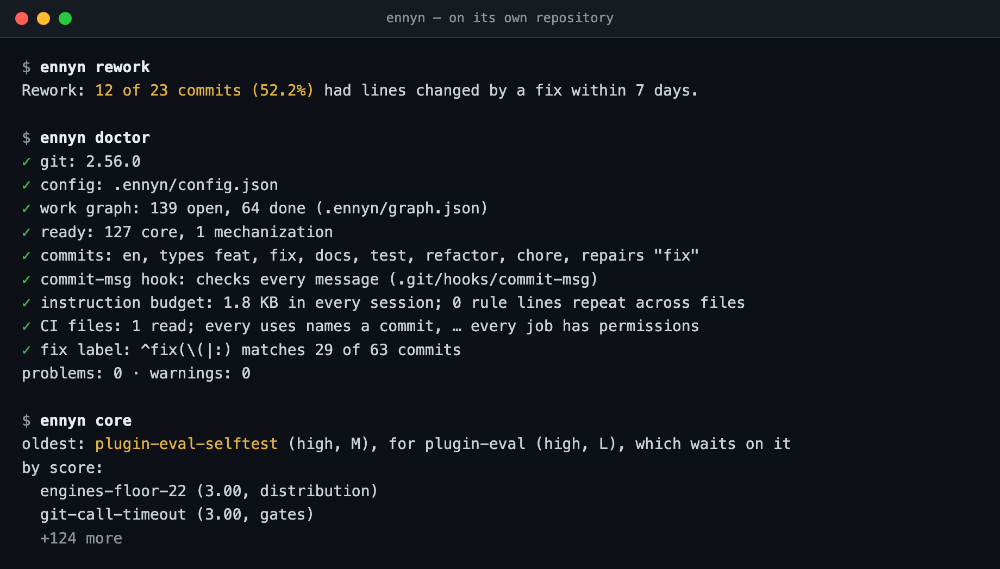
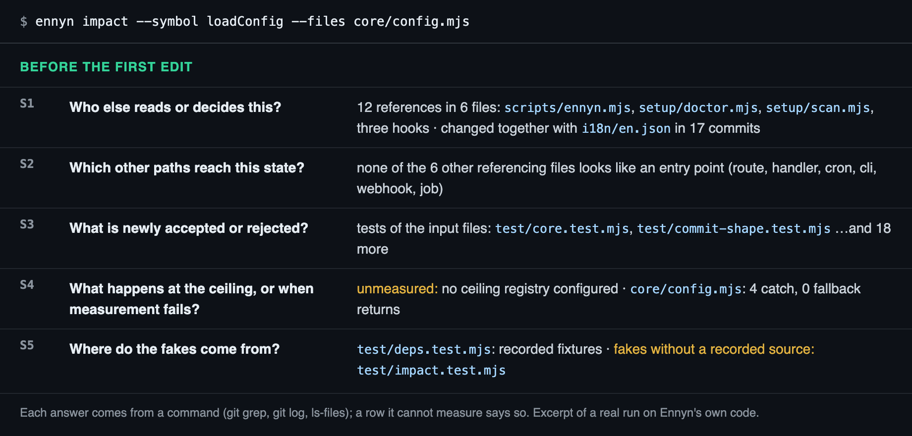

# Ennyn


[English](README.md) · **Türkçe**

[](LICENSE) [](package.json) [](package.json)

Ennyn, Claude Code için bir plugin ve Node CLI aracı. Agent'a bir çalışma düzeni getiriyor: kod yazılmadan önce etki analizi, iki turlu review ve tekrar eden hata sınıfları için her commit'te çalışan kontroller.



> Proje henüz erken aşamada (0.0.x). Ennyn, Claude Code ile ve kendi döngüsü kullanılarak geliştiriliyor; iş grafı, devir notları ve metrikleri `.ennyn/` klasöründe (ayarı gereği notlar Türkçe, commit'ler İngilizce). Config formatı 1.0'a kadar değişebilir.

## Neden Ennyn

Kodu bir agent'ın yazdığı bir projede zamanla şu sorunlar ortaya çıkar:

- Review bir hata bulur, agent düzeltir, düzeltme de çevresinde bir regression'a yol açar. Sonraki review bu regression'ı yakalar ve döngü böyle sürer.
- Bu hataları önleyecek sorular kod yazılmadan önce de sorulabilir (bu değeri başka hangi kod okuyor? bu state'e başka bir yoldan da ulaşılabilir mi?), ama genelde ancak review'da sorulur.
- Bir hatadan sonra CLAUDE.md'ye düz metin bir kural eklenir; birkaç hafta sonra aynı sınıftan bir hata yine çıkar.
- CLAUDE.md sürekli büyür ve her oturumda context'te yer kaplar; hangi kuralın gerçekten bir etkisi olduğunu ölçmenin bir yolu yoktur.

## Ne yapar

- Agent kodu değiştirmeden önce bir etki tablosu dolduruyor: değişikliğin nereleri etkilediğini soran beş soru. Her birini mümkün olduğunca git grep, git log ya da testleri çalıştırarak cevaplıyor.
- Review iki turla sınırlı. İkinci tur yalnızca ilk turdaki fix'lerin değiştirdiği yerlere bakıyor. Üçüncü tur ancak arkasında fail eden bir test ya da bir ölçüm varsa açılıyor.
- Bir hata sınıfı tekrar ediyorsa sonraki döngü (aşağıda adım adım anlatılıyor) onu bir gate'e, yani bir teste ya da commit hook kuralına çeviriyor. O sınıf için CLAUDE.md'deki düz metin kurala artık gerek kalmaz.
- Her döngü beş metrikle kapanıyor: review'ın bulduğu hatalar, fix'lerin yol açtığı regression'lar, Ennyn'den önceki kodda bulunan eski hatalar, gate'lerin yakaladığı hatalar ve commit'i geçip sonradan ortaya çıkan hatalar. Her oturumda yüklenen talimat metninin büyüyüp büyümediği de ölçülüyor.
- Görevler bir iş grafında, yani bir JSON dosyasında duruyor. Ennyn her döngüde bunlardan dördünü seçiyor ve değeri yüksek en eski göreve her zaman yer ayırıyor.

Ennyn'in runtime bağımlılığı da install script'i de yok. İnternete yalnızca iki durumda çıkıyor: bir commit, lock dosyasına paket eklediğinde commit hook'u bu paketleri npm registry'sinde sorguluyor (`security.deps.online: false` ile kapatabilirsiniz). `ennyn deps` komutunu çalıştırdığınızda da OSV güvenlik açığı veritabanını sorguluyor. Ayrıntılar [SECURITY.md](SECURITY.md) dosyasında (İngilizce).

Ennyn'in tasarımının gerekçeleri [docs/evidence.md](docs/evidence.md) dosyasında (İngilizce).

## Kurmadan deneyin

Aşağıdaki iki komut config olmadan da her git reposunda çalışır. Ennyn'i projenizin yanına, aynı üst klasöre klonlayın, sonra projenizin kök klasöründen şunları çalıştırın:

```sh
node ../ennyn/scripts/ennyn.mjs rework
node ../ennyn/scripts/ennyn.mjs budget
```

`rework`, satırları 7 gün içinde bir fix commit'iyle değişen commit'lerin oranını verir. `budget` ise agent'ınızın her oturumda yüklediği talimat metninin (CLAUDE.md, kurallar, skill ve agent açıklamaları) boyutunu ölçer.

## Kurulum (Claude Code)

```sh
claude plugin marketplace add boranb/ennyn
claude plugin install ennyn@ennyn
```

Sonra projenizde `/ennyn:init` çalıştırın. Komut repoyu tarar, birkaç soru sorar ve `.ennyn/` klasörünü hazırlar. Diğer projelerinizde plugin'in hook'ları, plugin'in sürümünü kendi klasörüne not etmek dışında hiçbir şey yapmaz.

Ennyn'in reposu public olana kadar marketplace'i yerel bir klondan `claude plugin marketplace add ./ennyn` ile ekleyin, sonra yukarıdaki install komutunu çalıştırın.

`skills/cycle/` klasöründeki, döngüyü yürüten cycle skill'i [Agent Skills](https://agentskills.io) formatındadır ama CLI'yi `${CLAUDE_PLUGIN_ROOT}` üzerinden çağırır; bu değişkeni yalnızca Claude Code tanımlar. Başka bir agent'la kullanmak için `CLAUDE_PLUGIN_ROOT` değişkenini bir Ennyn klonunun path'ine ayarlayın. CLI, Node 20 ya da üstünü ve git 2.34 ya da üstünü ister, bağımlılığı yoktur. Ennyn klonunun içinden `node scripts/ennyn.mjs --help` komutların listesini verir. README'nin geri kalanında geçen `ennyn`, projenizin içinden çalıştırılan bu script'in kısaltmasıdır.

## Bir döngü nasıl işler

İlk değişiklikten önce agent `ennyn impact` çalıştırır. Ennyn'de yapılan bir değişiklik için çıktı şöyle:



Bir döngünün adımları ve bu adımlarda geçerli ayarlar:

| Adım | Ne olur | Komutlar |
|---|---|---|
| Hazırlık | `/ennyn:init` soru sormadan önce repoya bakar: fix'ler nasıl etiketleniyor, commit'lerin çoğu hangi dosyaları yeniden yazıyor (genelde otomatik üretilen dosyalar), testler nerede, hangi path'ler riskli, projede bir yol haritası ya da issue'lar var mı. Sonra en fazla altı soru sorar; config'i, başlangıç iş grafını ve sonraki oturum için bir devir teslim notunu yazar. | `/ennyn:init`, `ennyn init-scan`, `ennyn doctor` |
| İş seçimi | Her döngü dört görev alır. Biri her zaman değeri yüksek görevlerin en eskisidir, böylece büyük işler sürekli ertelenmez (görev çok büyükse onun yerine ilk adımı seçilir). Diğer üçü maliyetine göre en çok değer getiren görev, en sık görülen hata türünü bir gate'e çeviren görev ve daha önce bitmiş bir işin denetimidir. | `ennyn core`, `ennyn mechanization` |
| Yazmadan önce | Etki tablosu. Beş sorunun her biri mümkün olduğunca bir komutla cevaplanır (git grep, git log ya da testler); hiçbir komutun cevaplayamadığı satırda bu açıkça belirtilir. Değişiklik bir heuristic ekliyorsa agent önce heuristic'in kabul etmesi ve reddetmesi gereken örnekleri, bir de fail eden bir test yazar. | `ennyn impact` |
| Mutation testi | Agent değişen satırlar için birkaç mutant (bilinçli olarak yerleştirilen küçük hata) seçer, projenin hızlı testleri her mutant için ayrı çalışır. Hayatta kalan, yani testlerin yakalamadığı bir mutant için yeni bir test ya da yazılı bir gerekçe gerekir. İşlem yarıda kesilse bile dosyalar eski hâline döner. Mutant içindeyken biri dosyayı düzenlerse Ennyn o dosyaya dokunmaz ve işlemi durdurur. | `ennyn mutate` |
| Review | İki tur; üçüncüsü ancak fail eden bir test ya da bir ölçümle açılır. Her bulgu ilgili kodu alıntılar, kaynağını belirtir (yeni kod, önceki bir fix ya da eski kod) ve nasıl doğrulandığını yazar. | `agents/`, `skills/cycle/finding-schema.md` |
| Commit | Bir commit-msg hook'u her commit'i kontrol eder. Yasakladığınız kalıpları (`review.forbidden`) ve bilinen token formatlarındaki secret'leri engeller; kod değişip ona bağlı dokümanlar güncellenmezse uyarır (`review.cochange`). | `ennyn commit-check`, `ennyn install-hook` |
| Push'lar | Claude Code'un ask kuralının kesin okuyamadığı bir komuttaki `git push`'u bir hook reddeder ve agent'a nasıl yazması gerektiğini söyler. Bu alışkanlığı yakalar, kararlı bir programı değil. | Claude Code hook'u |
| Gate süreleri | Commit kontrollerinin ne kadar sürdüğü ve ne sıklıkla fail ettiği kendi makinenizde kaydedilir. | `ennyn gate-record`, `ennyn gate-stats` |
| Ton | Agent'ın sizinle nasıl konuşacağını (`focused` ya da `terse`) ve commit mesajlarının uzunluğunu siz seçersiniz. Sayılar, path'ler ve uyarılar hiçbir zaman atlanmaz. | `conversation.style`, `commitMsg.style` |
| Worktree'ler | Agent bir git worktree'sinde ya da projenin bir kopyasında çalışırken de path'e özel kuralları alır. | Claude Code hook'u |
| Sıkıştırma | Claude Code, bir görevin ortasında turu bitmiş halde bıraktığınız oturumu özetlemez: boşta sıkıştırma commit'i bekler. Oturumun ihtiyaç duyduğu sıkıştırma her zamanki gibi sürer; her özetten görevi, dosyalarını ve sırada ne olduğunu yazması istenir. Sıkıştırmadan sonra ajandan, bir sonraki düzenlemeden önce görevinin değiştirdiği dosyaları ve etki tablosunu yeniden okuması istenir. `compaction.defer: false` üçünü de kapatır. | Claude Code hook'u, `compaction.defer` |
| Döngü sonu | Döngü sonunda beş metrik raporlanır ve en sık görülen hata türü bir sonraki döngünün gate görevi olur. Agent bir ders dosyasını (projenin geçmiş hatalardan çıkardığı yazılı notları) temizler ve artık bir gate'in karşıladığı dersleri siler. Bağımlılıkları ve CI dosyalarını da kontrol eder, döngünün çalışma ağacında bıraktıklarını da listeler (yeni izlenmeyen dosyalar, commit'lenmemiş değişiklikler), adını verdiyseniz projenizin kendi artık aracını da koşar: her birini size sorar, hiçbirini silmez. Döngünün açtığı worktree'leri de içlerinde kaybolacak bir şey yoksa kaldırır. Birkaç döngüde bir güvenlik denetimi yapılır. Agent her push'tan önce size sorar. | `ennyn push-check`, `ennyn rework`, `ennyn bypass`, `ennyn budget`, `ennyn deps`, `ennyn leftovers`, `ennyn worktrees`, `ennyn audit` |

`ennyn rework`'ün sonucu, projenizin fix'leri nasıl etiketlediğine bağlıdır. Commit başlıklarınızın çoğu "fix" ile başlıyorsa komut rework'ten çok churn ölçer ve bunu size söyler. `metrics.fixSubject`'i gerçek fix commit'lerinizi yakalayacak şekilde ayarlayın; bu kalıbın `commitMsg.fixType` ile de eşleşmesi gerekir ([ayrıntılar](docs/evidence.md#speed-and-rework)).

## Ayarlar

Tüm ayarlar tek bir dosyada durur: `/ennyn:init`'in sizin için yazdığı `.ennyn/config.json`. Dosyaya yalnızca varsayılandan farklı ayarları yazmanız yeterli. Bilinmeyen anahtarlar ve yanlış tipler tek seferde raporlanır; böylece bir yazım hatası bir kontrolü sessizce kapatamaz. Config'deki path'ler proje içinde kalmak zorundadır.

```json
{
  "language": "tr",
  "paths": { "graph": ".ennyn/graph.json" },
  "commitMsg": { "types": ["feat", "fix", "docs", "test", "refactor", "chore"], "fixType": "fix" },
  "review": { "impactRequiredGlobs": ["src/auth/**", "migrations/**"] },
  "impact": { "twins": [["src/lib/engine", "server/src/lib"]] }
}
```

`language` (`en` ya da `tr`) raporların ve agent'ın cevaplarının dilini belirler. Commit mesajları `commitMsg.language` ayarına uyar; böylece Türkçe konuşup İngilizce commit atabilirsiniz. Hook, `commitMsg.types` içindeki commit tiplerini kabul eder. `commitMsg.fixType` ise önceki commit'leri onaran fix'lere ayrılmış tiptir; `ennyn rework` de bu fix'leri sayar. `/ennyn:init` commit tiplerini ve fix tipini ayarlar; ikisi de kendi talimatlarınızdaki commit kurallarından öncelikli olur. Anahtarların tam listesi [DESIGN.md](DESIGN.md) dosyasında (İngilizce).

İş grafı bir JSON dosyasıdır (ya da ES modülü): açık görevler ve bitmiş görevler için iki ayrı dizi içerir. Field adları ayarlanabildiği için Ennyn'i elinizdeki bir grafa yönlendirebilirsiniz.

## Durum ve yol haritası

- **0.1** (sıradaki): ilk public sürüm; plugin, `/ennyn:init` ve CLI bugünkü hâliyle.
- **0.2**: Codex desteği, aynı projeyi plugin'li ve plugin'siz karşılaştıran `claude plugin eval` senaryoları ve ikinci bir projeden sonuçların yayımlanması.
- **1.0**: kararlı bir config formatı.

## Lisans

MIT. Lisans metni [LICENSE](LICENSE) dosyasında.

## Ad

*Ennyn* (okunuşu *EN-nin*) Sindarin dilinde "kapılar" demek. *Yüzüklerin Efendisi*'nde Durin Kapıları'nın üstündeki yazıtın ilk kelimesi; o kapılar yalnızca doğru kelime söylenince açılır. Ennyn'de de kodunuzun geçmesi gereken kontrollere gate, yani kapı denir.

Adın kullanımı için kısa bir politika var: [TRADEMARK.md](TRADEMARK.md) (İngilizce). Ennyn'in Tolkien Estate, Middle-earth Enterprises ya da bunların lisans verdiği şirketlerle hiçbir bağlantısı yoktur; bu kurumlar Ennyn'i ne destekler ne de onaylar.
