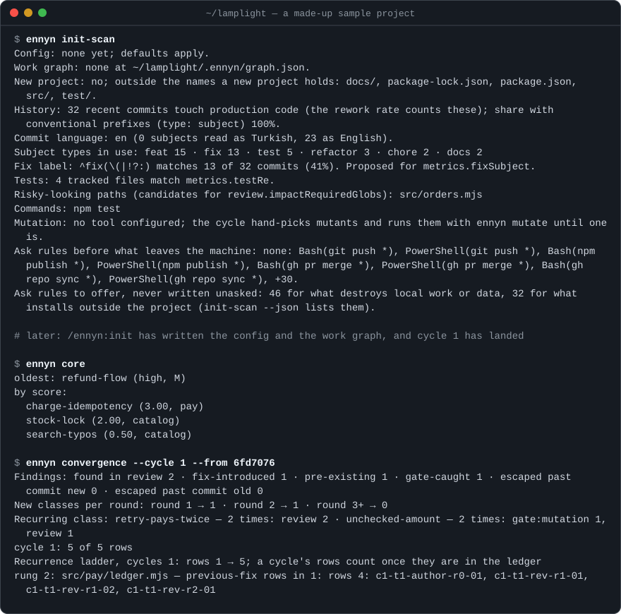

# Ennyn


[English](README.md) · **Türkçe**

[](LICENSE) [](package.json) [](package.json)

Ennyn, Claude Code için bir plugin ve Node CLI aracı. Agent'a bir çalışma düzeni getiriyor: kod yazılmadan önce etki analizi, iki turlu review ve tekrar eden hata sınıfları için her commit'te çalışan kontroller.

[Kurulum](#kurulum-claude-code) · [Kurmadan deneyin](#kurmadan-deneyin)



Uydurma bir mağaza projesi, bir döngüden önce ve sonra: `ennyn init-scan`, `/ennyn:init` daha hiçbir şey sormadan repoyu okuyor; `ennyn core` iş grafından sıradaki görevi seçiyor; `ennyn convergence` da döngüdeki kontrollerin ve review'ların bulduklarını sayıyor. Görüntü bir Claude oturumunun kaydı değil, CLI'ın kendi çıktısı.

> Proje henüz erken aşamada (0.1.x). Ennyn, Claude Code ile ve kendi döngüsü kullanılarak geliştiriliyor; iş grafı, bulguları ve metrikleri `.ennyn/` klasöründe; döngüler arası devir notları çalışma notu olduğu için repo dışında tutuluyor. Config formatı 1.0'a kadar değişebilir.

## Neden Ennyn

Kodu bir agent'ın yazdığı bir projede zamanla şu sorunlar ortaya çıkar:

- Review bir hata bulur, agent düzeltir, düzeltme de çevresinde bir regression'a yol açar. Sonraki review bu regression'ı yakalar ve döngü böyle sürer.
- Bu hataları önleyecek sorular kod yazılmadan önce de sorulabilir (bu değeri başka hangi kod okuyor? bu state'e başka bir yoldan da ulaşılabilir mi?), ama genelde ancak review'da sorulur.
- Bir hatadan sonra CLAUDE.md'ye düz metin bir kural eklenir; birkaç hafta sonra aynı sınıftan bir hata yine çıkar.
- CLAUDE.md sürekli büyür ve her oturumda context'te yer kaplar; hangi kuralın gerçekten bir etkisi olduğunu ölçmenin bir yolu yoktur.

## Ne yapar

- Agent kodu değiştirmeden önce bir etki tablosu dolduruyor: değişikliğin nereleri etkilediğini soran beş soru. Her birini mümkün olduğunca git grep, git log ya da testleri çalıştırarak cevaplıyor. Değerine göre seçilen bir görevde önce her yeni parçayı, onu isteyen görev satırıyla ve onu zaten neyin yaptığıyla listeliyor.
- Review iki turla sınırlı. İkinci tur yalnızca ilk turdaki fix'lerin değiştirdiği yerlere bakıyor. Ondan sonra bir fix'i fail eden bir test kanıtlar, yeni bir tur değil.
- Bir hata sınıfı tekrar ediyorsa sonraki döngü (aşağıda adım adım anlatılıyor) onu bir gate'e, yani bir teste ya da commit hook kuralına çeviriyor. O sınıf için CLAUDE.md'deki düz metin kurala artık gerek kalmaz.
- Her döngü beş metrikle kapanıyor: review'ın bulduğu hatalar, fix'lerin yol açtığı regression'lar, Ennyn'den önceki kodda bulunan eski hatalar, gate'lerin yakaladığı hatalar ve commit'i geçip sonradan ortaya çıkan hatalar. Her oturumda yüklenen talimat metninin büyüyüp büyümediği de ölçülüyor.
- Görevler bir iş grafında, yani bir JSON dosyasında duruyor. Ennyn her döngüde bunlardan dördünü seçiyor ve değeri yüksek en eski göreve her zaman yer ayırıyor.

Ennyn'in runtime bağımlılığı da install script'i de yok. Marketplace'i eklemek bu repoyu klonlar, plugin'i kurmak da yalnızca `plugin/` klasörünü kopyalar; npm'den hiçbir şey gelmez, bağımlılık indirilmez. İnternete yalnızca şu durumlarda çıkar:

- Bir commit lock dosyasına paket eklediğinde commit hook'u her yeni paketi npm registry'sinde sorgular (`registry.npmjs.org`, `api.npmjs.org`). Bunu `security.deps.online: false` ile kapatabilirsiniz.
- `ennyn deps`, açık registry'den gelen her paketin adını ve sürümünü OSV güvenlik açığı veritabanına gönderir (`api.osv.dev`). Bunu siz çalıştırdığınızda ve her döngünün sonunda yapar; `security.deps.advisories: ""` ile kapatabilirsiniz.
- `ennyn push-check` dalınızın remote'unda `git fetch` çalıştırır; döngünün sonunda agent da oraya push eder. `push.mode` değerini `after-closing` yapmadıysanız önce size sorar.
- `ennyn clone-setup`, `commits.signed` açıksa bir GitHub hesabının herkese açık SSH imzalama anahtarlarını `api.github.com` adresinden okur; token göndermez. Hesap, `--login` ile verdiğiniz ya da `commits.addresses` içindeki bir GitHub noreply adresinin gösterdiği hesaptır.
- `/ennyn:init` sırasında, reponun GitHub'da bir remote'u varsa ve `gh` kuruluysa, agent açık GitHub issue'larınızı `gh` ile listeler.
- Yeni bir projede, hangi teknolojilerle çalışılacağında anlaştıktan sonra agent projenin iskeletini kurar ve paketleri seçtiğiniz paket yöneticisiyle yükler; paketler o paket yöneticisinin registry'sinden iner. Bu ilk kurulumdan önce `/ennyn:init`, npm'in nereye ve hangi ayarlarla kuracağına bakar (`npm prefix`, `npm config get`). Bu sırada npm de kendi registry'sine daha yeni bir npm çıkıp çıkmadığını sorabilir; npm ayarlarınıza `update-notifier=false` ekleyerek bunu kapatabilirsiniz.
- Partial clone'da git, eksik nesneleri her git komutunda olduğu gibi remote'unuzdan kendisi çeker.

Ennyn; git, Node ve birkaç sistem aracı (`ps`, `sysctl`, `taskkill`, kendi süreçleri ve boş bellek için) dışında yalnızca sizin verdiğiniz komutları çalıştırır: config'teki test komutları, `ennyn mutate`'e verdiğiniz komut ve `impact.referenceCommand`. Reponuzun dışında yalnızca şuralara yazar: plugin'in kendi veri klasörüne (her oturumun çalıştırdığı sürüm), oturumun ortam dosyasına (iki `ENNYN_` değişkeni), `ennyn lock` kullanırsanız `~/.ennyn-lock` klasörüne ve geçici klasörlere. Repo içinde durumunu `.git/ennyn` klasöründe tutar. `ennyn worktrees --remove`, bir döngünün kendine ait diye işaretlediği worktree'lerin klasörlerini siler; yalnızca hiçbir şey kaybettirmeyecek olanları. Commit hook'u yalnızca siz isterseniz kurulur. `/ennyn:init` Claude Code ayarlarına ancak siz evet derseniz dokunur: ask kurallarını ve plan onayı seçeneğini `.claude/settings.json` dosyasına, bypass modu olmadan çalışma ayarlarını da seçtiğiniz dosyaya, `.claude/settings.local.json` ya da `.claude/settings.json` dosyasına yazar. Ayrıntılar [SECURITY.md](SECURITY.md#what-ennyn-runs-on-a-machine) dosyasında (İngilizce).

Ennyn'in tasarımının gerekçeleri [docs/evidence.md](docs/evidence.md) dosyasında (İngilizce). Şu ana kadar işe yarayıp yaramadığını, düzelmeyen yanlarıyla birlikte, [Does it work yet?](docs/evidence.md#does-it-work-yet) bölümünde bulabilirsiniz.

## Kurmadan deneyin

Aşağıdaki iki komut config olmadan da her git reposunda çalışır. Ennyn'i projenizin yanına, aynı üst klasöre klonlayın, sonra projenizin kök klasöründen şunları çalıştırın:

```sh
node ../ennyn/scripts/ennyn.mjs rework
node ../ennyn/scripts/ennyn.mjs budget
```

`rework`, satırları 7 gün içinde bir fix commit'iyle değişen commit'lerin oranını verir. `budget` ise agent'ınızın her oturumda yüklediği talimat metninin (CLAUDE.md, kurallar, skill ve agent açıklamaları) boyutunu ölçer.

## Kurulum (Claude Code)

```sh
claude plugin marketplace add boranb/ennyn
claude plugin install ennyn@ennyn
```

Sonra projenizde `/ennyn:init` çalıştırın. Komut repoyu tarar, birkaç soru sorar ve `.ennyn/` klasörünü hazırlar. Diğer projelerinizde plugin'in hook'ları, plugin'in sürümünü kendi klasörüne not edip oturuma bildirmek dışında hiçbir şey yapmaz.

Ennyn'i yalnızca `github.com/boranb/ennyn` adresinden kurun: yukarıdaki komutlarla ya da bir klondan. Asıl Ennyn'de çalıştırılabilir dosya, çalışma zamanı bağımlılığı ya da kurulum script'i yoktur. Çalıştırılabilir dosya getiren ya da sizden bir kurulum programı çalıştırmanızı isteyen bir kopya Ennyn değildir.

### Güncelleme

```sh
claude plugin marketplace update ennyn
claude plugin update ennyn@ennyn
```

Ardından Claude Code'u yeniden başlatın. Plugin'den kurulan commit-msg hook'u yeni sürümü kendiliğinden izler; projelerinizde yeniden çalıştırılacak bir şey yoktur. Klonla kullanıyorsanız `git pull` yeter.

### Kaldırma

Önce `/ennyn:init` çalıştırdığınız her projede commit-msg hook'unu ve Ennyn'in durum klasörünü kaldırın. Bir Claude Code oturumunda agent'tan `node "$ENNYN_PLUGIN_ROOT/scripts/ennyn.mjs" uninstall-hook` komutunu çalıştırmasını isteyin; klonla kullanıyorsanız `ennyn uninstall-hook` çalıştırın. Komut hook'u yalnız `install-hook` yazdıysa ve o zamandan beri kimse değiştirmediyse siler. Düzenlediğiniz bir hook ya da izlenen bir hooks klasöründeki veya husky'ninkindeki hook yerinde kalır: komut hangi dosyadan hangi satırların çıkarılacağını söyler. Ardından `.git/ennyn` klasörünü siler ve karar size kalanları listeler: `.ennyn/config.json`, iş grafiği, handoff, metrik ve bulgu kayıtları, init'in `.claude/settings.json` dosyasına eklediği ask kuralları. Bunları silebilir ya da tutabilirsiniz; hepsi reponuzdaki sıradan dosyalardır.

Sonra plugin'i ve geldiği marketplace'i kaldırın:

```sh
claude plugin uninstall ennyn@ennyn
claude plugin marketplace remove ennyn
```

Plugin'i kaldırmak, hook'un plugin sürümünü okuduğu veri klasörünü de siler. Bir projede kalmış hook bundan sonra her commit'i bir notla geçirir; klondan çalıştırılan `uninstall-hook` onu yine de siler. `--keep-data` o klasörü tutar; onunla birlikte hook, Claude Code'un 14 gün sonra sildiği bir sürümü göstermeye devam eder ve o günden sonra her commit reddedilir. Bu yüzden önce hook'ları kaldırın.

`plugin/skills/cycle/` klasöründeki, döngüyü yürüten cycle skill'i [Agent Skills](https://agentskills.io) formatındadır ama CLI'yi `${CLAUDE_PLUGIN_ROOT}` üzerinden çağırır; bu değişkeni yalnızca Claude Code tanımlar. Başka bir agent'la kullanmak için `CLAUDE_PLUGIN_ROOT` değişkenini bir Ennyn klonunun `plugin` klasörünün path'ine ayarlayın. CLI, Node 22 ya da üstünü ve git 2.34 ya da üstünü ister, bağımlılığı yoktur. Ennyn klonunun içinden `node scripts/ennyn.mjs --help` komutların listesini verir. README'nin geri kalanında geçen `ennyn`, projenizin içinden çalıştırılan bu script'in kısaltmasıdır.

Ennyn Linux'ta ve macOS'ta, Windows'ta da WSL üzerinden çalışır; test takımının tamamı orada en son 2026-11-09'da, `c5d7b70` commit'inde geçti (Ubuntu 22.04, git 2.34.1). macOS 27.2'de (Node 22.23.4, git 2.56.0) takımın tamamı en son 2026-11-28'de, `v0.1.2`'de geçti; Linux'ta da aynı gün, alt sınırdaki kapsayıcıda (Node 22.0.0, git 2.34.1) ve Node 24.22.1'de (git 2.39.5). Doğrudan Windows'ta (Git for Windows 2.47.1, Git Bash, PowerShell 7) push hook'u, commit-msg hook'u, gate gevşetme kontrolü ve plugin'in sürüm kaydı en son 2026-11-05'te, `41cfa37` commit'inde ölçüldü ve tutuyor, [SECURITY.md](SECURITY.md)'nin söylediği gibi; test takımı orada geçmez, sıkıştırma hook'u yalnız bir test projesinde denendi, diğer hook'lar ölçülmedi.

## Bir döngü nasıl işler

İlk değişiklikten önce agent `ennyn impact` çalıştırır. Ennyn'de yapılan bir değişiklik için çıktı şöyle:


Bir döngünün adımları ve bu adımlarda geçerli ayarlar:

| Adım | Ne olur | Komutlar |
|---|---|---|
| Hazırlık | `/ennyn:init` soru sormadan önce repoya bakar: fix'ler nasıl etiketleniyor, commit'lerin çoğu hangi dosyaları yeniden yazıyor (genelde otomatik üretilen dosyalar), testler nerede, hangi path'ler riskli, projede bir yol haritası ya da issue'lar var mı. Sonra en fazla altı soru sorar; config'i, başlangıç iş grafını ve sonraki oturum için bir devir teslim notunu yazar. Yalnızca bir README, bir lisans, `.gitignore` ve agent talimat dosyaları olan yeni bir projede yalnızca config'in ve ilk iş grafının gerektirdiğini sorar; repo dışında `git init` önerir. Agent'ın sırlarla nasıl çalıştığını da söyler (bypass, sandbox, `.env` ve SSH anahtarları için Read kuralları, `.mcp.json`'daki token'lar) ve bypass'sız çalışmayı önerir. Ask kurallarını ve plan onayı seçeneğini `.claude/settings.json` dosyasına, bypass'sız çalışma ayarlarını da `.claude/settings.local.json` ya da `.claude/settings.json` dosyasına ancak siz evet derseniz yazar. | `/ennyn:init`, `ennyn init-scan`, `ennyn doctor` |
| İş seçimi | Her döngü dört görev alır. Biri her zaman değeri yüksek görevlerin en eskisidir, böylece büyük işler sürekli ertelenmez (görev çok büyükse onun yerine ilk adımı seçilir). Diğer üçü maliyetine göre en çok değer getiren görev, en sık görülen hata türünü bir gate'e çeviren görev ve daha önce bitmiş bir işin denetimidir. Adıyla tek bir görev ya da tek bir fix istendiğinde (fix önce bir görev olarak yazılır), döngü onu aynı adımlarla ve aynı döngü sonuyla tek başına yürütür; gate görevi ve denetim olmaz. | `ennyn core`, `ennyn mechanization` |
| Yazmadan önce | Etki tablosu. Beş sorunun her biri mümkün olduğunca bir komutla cevaplanır (git grep, git log ya da testler); hiçbir komutun cevaplayamadığı satırda bu açıkça belirtilir. Değişiklik bir heuristic ekliyorsa agent önce heuristic'in kabul etmesi ve reddetmesi gereken örnekleri, bir de fail eden bir test yazar. Değerine göre seçilen bir görev önce bir en küçük değişiklik satırını da cevaplar: her yeni parçayı görevin hangi satırı istiyor, depo, platform, git ya da kurulu bir bağımlılık bunu zaten yapıyor mu. Girdi doğrulaması, veri kaybına karşı önlem, güvenlik ve erişilebilirlik hiçbir zaman kısılmaz. | `ennyn impact` |
| Mutation testi | Agent değişen satırlar için birkaç mutant (bilinçli olarak yerleştirilen küçük hata) seçer, projenin hızlı testleri her mutant için ayrı çalışır. Hayatta kalan, yani testlerin yakalamadığı bir mutant için yeni bir test ya da yazılı bir gerekçe gerekir. İşlem yarıda kesilse bile dosyalar eski hâline döner. Mutant içindeyken biri dosyayı düzenlerse Ennyn o dosyaya dokunmaz ve işlemi durdurur. | `ennyn mutate` |
| Ağır işler | Tüm test takımı, bir mutation koşusu ya da bir platform imajı makinenizdeki tek kuyrukta sırasını bekler (her oturum ve proje aynı kuyruğu kullanır) ve bir süre sınırıyla koşar. Sırası ancak makinede yer varken başlar: yeterince boş bellek ve disk, işlemcilerin taşıyabileceği bir yük; o zamana kadar yerini tutar, neyin eksik olduğunu söyler ve süre sınırı dolunca yine de başlar. Takılan bir koşu başlattığı her şeyle birlikte durdurulur, ölen bir koşu da kuyruğu geri verir. | `ennyn lock` |
| Review | İki tur; üçüncüsü ancak fail eden bir test ya da bir ölçümle açılır. Her bulgu ilgili kodu alıntılar, kaynağını belirtir (yeni kod, önceki bir fix ya da eski kod) ve nasıl doğrulandığını yazar. | `plugin/agents/`, `plugin/skills/cycle/finding-schema.md` |
| Commit | Bir commit-msg hook'u her commit'i kontrol eder. Yasakladığınız kalıpları (`review.forbidden`) ve bilinen token formatlarındaki secret'leri engeller; kod değişip ona bağlı dokümanlar güncellenmezse uyarır (`review.cochange`). | `ennyn commit-check`, `ennyn install-hook` |
| Push'lar | Claude Code'un ask kuralının kesin okuyamadığı bir komuttaki `git push`'u bir hook reddeder ve agent'a nasıl yazması gerektiğini söyler. Bu alışkanlığı yakalar, kararlı bir programı değil. | Claude Code hook'u |
| Gate süreleri | Commit kontrollerinin ne kadar sürdüğü ve ne sıklıkla fail ettiği kendi makinenizde kaydedilir. | `ennyn gate-record`, `ennyn gate-stats` |
| Ton | Agent'ın sizinle nasıl konuşacağını (`focused` ya da `terse`) ve commit mesajlarının uzunluğunu siz seçersiniz. Sayılar, path'ler ve uyarılar hiçbir zaman atlanmaz. | `conversation.style`, `commitMsg.style` |
| Worktree'ler | Agent bir git worktree'sinde ya da projenin bir kopyasında çalışırken de path'e özel kuralları alır. | Claude Code hook'u |
| Sıkıştırma | Claude Code, bir görevin ortasında turu bitmiş halde bıraktığınız oturumu özetlemez: boşta sıkıştırma commit'i bekler. Oturumun ihtiyaç duyduğu sıkıştırma her zamanki gibi sürer; her özetten görevi, dosyalarını ve sırada ne olduğunu yazması istenir. Sıkıştırmadan sonra ajandan, bir sonraki düzenlemeden önce görevinin değiştirdiği dosyaları ve etki tablosunu yeniden okuması istenir. `compaction.defer: false` üçünü de kapatır. | Claude Code hook'u, `compaction.defer` |
| Döngü sonu | Döngü sonunda beş metrik raporlanır ve en sık görülen hata türü bir sonraki döngünün gate görevi olur. Agent bir ders dosyasını (projenin geçmiş hatalardan çıkardığı yazılı notları) temizler ve artık bir gate'in karşıladığı dersleri siler. Bağımlılıkları ve CI dosyalarını da kontrol eder, döngünün çalışma ağacında bıraktıklarını da listeler (yeni izlenmeyen dosyalar, commit'lenmemiş değişiklikler), adını verdiyseniz projenizin kendi artık aracını da koşar: her birini size sorar, hiçbirini silmez. Döngünün açtığı worktree'leri de içlerinde kaybolacak bir şey yoksa kaldırır. Birkaç döngüde bir güvenlik denetimi yapılır. Agent push'tan önce size sorar; `push.mode`'u `after-closing` yaparsanız sormaz. | `ennyn push-check`, `ennyn rework`, `ennyn bypass`, `ennyn budget`, `ennyn deps`, `ennyn leftovers`, `ennyn worktrees`, `ennyn audit` |

`ennyn rework`'ün sonucu, projenizin fix'leri nasıl etiketlediğine bağlıdır. Commit başlıklarınızın çoğu "fix" ile başlıyorsa komut rework'ten çok churn ölçer ve bunu size söyler. `metrics.fixSubject`'i gerçek fix commit'lerinizi yakalayacak şekilde ayarlayın; bu kalıbın `commitMsg.fixType` ile de eşleşmesi gerekir ([ayrıntılar](docs/evidence.md#speed-and-rework)).

## Ayarlar

Tüm ayarlar tek bir dosyada durur: `/ennyn:init`'in sizin için yazdığı `.ennyn/config.json`. Dosyaya yalnızca varsayılandan farklı ayarları yazmanız yeterli. Bilinmeyen anahtarlar ve yanlış tipler tek seferde raporlanır; böylece bir yazım hatası bir kontrolü sessizce kapatamaz. Config'deki path'ler proje içinde kalmak zorundadır.

```json
{
  "language": "tr",
  "paths": { "graph": ".ennyn/graph.json" },
  "commitMsg": { "types": ["feat", "fix", "docs", "test", "refactor", "chore"], "fixType": "fix" },
  "review": { "impactRequiredGlobs": ["src/auth/**", "migrations/**"] },
  "impact": { "twins": [["src/lib/engine", "server/src/lib"]] }
}
```

`language` (`en` ya da `tr`) raporların ve agent'ın cevaplarının dilini belirler. Commit mesajları `commitMsg.language` ayarına uyar; böylece Türkçe konuşup İngilizce commit atabilirsiniz. Hook, `commitMsg.types` içindeki commit tiplerini kabul eder. `commitMsg.fixType` ise önceki commit'leri onaran fix'lere ayrılmış tiptir; `ennyn rework` de bu fix'leri sayar. `/ennyn:init` commit tiplerini ve fix tipini ayarlar; ikisi de kendi talimatlarınızdaki commit kurallarından öncelikli olur. Anahtarların tam listesi [DESIGN.md](DESIGN.md) dosyasında (İngilizce).

İş grafı bir JSON dosyasıdır (ya da ES modülü; onu okuyan komutlar modülü içe aktarıp çalıştırır, bu yüzden klonlanan bir projenin graf modülü incelenecek koddur): açık görevler ve bitmiş görevler için iki ayrı dizi içerir. Field adları ayarlanabildiği için Ennyn'i elinizdeki bir grafa yönlendirebilirsiniz.

## Ennyn ne zaman uymaz

- Şimdilik yalnızca Claude Code'da çalışıyor.
- Rework, fix etiketi kadar güvenilir: `ennyn rework`, konusunda fix tipi geçen commit'leri sayar; onarımlarını işaretlemeyen bir projede çıkan sayı pek bir şey söylemez.
- Şimdilik Node 22 ve git 2.34 ya da daha yenisi gerekiyor.
- Config 1.0'dan önce değişebilir.

## Sözlük

- **İş grafı**: döngünün görev seçtiği, açık ve bitmiş görevlerin dosyası.
- **Döngü**: graftan dört görevlik bir tur; bir rapor ve bir devir notuyla biter.
- **Kapı (gate)**: reddeden bir kontrol (commit hook'u, bir izin kuralı, commit'in geçmesi gereken bir test); agent'a söylenen tavsiyeden farklıdır.
- **Mekanizasyon**: sürekli geri gelen bir hata türünü kapıya, teste, tipe ya da lint kuralına çeviren görev.
- **Eski kod denetimi (legacy audit)**: bitmiş bir özelliği ya da projenin güvenliğini yeniden kontrol eden görev.
- **Yan kopya (side copy)**: projenin başka bir dizindeki kopyası (geçici bir klasör ya da worktree); agent orada çalışır, projenin kuralları da onunla gider.
- **Yakınsama (convergence)**: bir döngünün sonunda bulguları geldikleri yere göre sayan rapor; review'ın yeni sorun bulmayı azaltıp azaltmadığını gösterir.
- **Etki tablosu (impact table)**: riskli bir değişiklikten önce yazılan, değişen şeyi başka neyin okuduğunu ya da ona neyin dayandığını sıralayan kısa tablo.

## Değiştirebileceğiniz ayarlar

| Ayar | Neyi değiştirir |
|---|---|
| `language` | Raporların, CLI çıktısının ve agent cevaplarının dili (`en` ya da `tr`). |
| `conversation.style` | Agent'ın sizinle nasıl konuştuğu: `focused` ya da `terse` (varsayılan `normal`). Sayılar, path'ler ve uyarılar hiçbir zaman kısaltılmaz. |
| `commitMsg.language`, `commitMsg.style` | Commit metninin dili; `terse` gövdeyi yapılandırılmış satırlarla sınırlar. |
| `push.mode` | Kapanıştaki push'a kimin evet dediği: `ask` (siz, varsayılan) ya da `after-closing`. |
| `compaction.defer` | Boşta compaction'ın, görev yarımken bekleyip beklemeyeceği (varsayılan açık). |
| `review.agents` | Döngünün kullandığı reviewer agent'lar; boşsa Ennyn'in üçü. |

Hiçbir ayar bir kapıyı kapatmaz. Anahtarların tam listesi [DESIGN.md](DESIGN.md) dosyasında (İngilizce).

## Durum ve yol haritası

- **0.1** (2026-11-18): ilk public sürüm; plugin, `/ennyn:init` ve CLI.
- **0.2**: Codex desteği, aynı projeyi plugin'li ve plugin'siz karşılaştıran `claude plugin eval` senaryoları ve ikinci bir projeden sonuçların yayımlanması, gözetimsiz döngüler için bir terminal runner'ı, secret'lar için çıktı maskeleme ve backlog'un triyajı.
- **1.0**: kararlı bir config formatı.

## Lisans

MIT. Lisans metni [LICENSE](LICENSE) dosyasında.

## Ad

*Ennyn* (okunuşu *EN-nin*) Sindarin dilinde "kapılar" demek. *Yüzüklerin Efendisi*'nde Durin Kapıları'nın üstündeki yazıtın ilk kelimesi; o kapılar yalnızca doğru kelime söylenince açılır. Ennyn'de de kodunuzun geçmesi gereken kontrollere gate, yani kapı denir.

Adın kullanımı için kısa bir politika var: [TRADEMARK.md](TRADEMARK.md) (İngilizce). Ennyn'in Tolkien Estate, Middle-earth Enterprises ya da bunların lisans verdiği şirketlerle hiçbir bağlantısı yoktur; bu kurumlar Ennyn'i ne destekler ne de onaylar.
